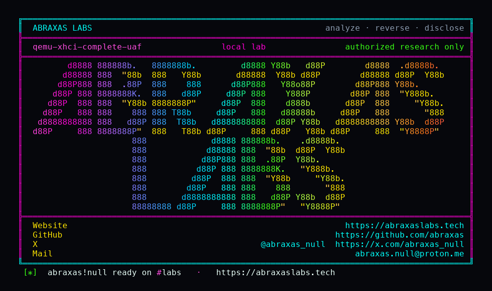

<p align="center">
  
</p>

<p align="center">
  <a href="https://abraxaslabs.tech"><strong>abraxaslabs.tech</strong></a>
  &nbsp;·&nbsp;
  <a href="https://github.com/abraxas">github.com/abraxas</a>
  &nbsp;·&nbsp;
  <a href="https://x.com/abraxas_null">@abraxas_null</a>
  &nbsp;·&nbsp;
  <a href="mailto:abraxas.null@proton.me">abraxas.null@proton.me</a>
  &nbsp;·&nbsp;
  <a href="https://github.com/abraxas/qemu-xhci-complete-uaf">qemu-xhci-complete-uaf</a>
</p>

# qemu-xhci-complete-uaf

**QEMU** `v11.1.2` (`4fc49f46dc95d4a27de2509e7fceb2931e91faeb`) - qemu-xhci

**Class:** UAF (heap use-after-free). **Reach:** Local (guest).

[`xhci_complete`](https://github.com/qemu/QEMU/blob/v11.1.2/hw/usb/hcd-xhci.c) is the leftover of [CVE-2026-17588](https://www.cve.org/CVERecord?id=CVE-2026-17588). The 11.1.2 patch guards the two xHCI timers. It does not guard the async USB complete path. A guest that aims the event ring at the doorbell BAR still gets a 16-byte TRB DMA-written into doorbell 0 from `xhci_complete`, with the TYPE_XHCI `mem_reentrancy_guard` already clear. That write runs `xhci_process_commands`. A prepared `CR_DISABLE_SLOT` frees the live `XHCITransfer` while `xhci_complete` still holds it.

q35 ships qemu-xhci. The bulk partner in this lab is `usb-uas`. The same complete callback is reachable from `usb-storage`, `usb-redir`, and `usb-host`.

**A guest kernel on qemu-xhci plus an async bulk device can UAF the QEMU process heap.**

| | |
|---|---|
| ID | no CVE yet |
| CWE | [CWE-416](https://cwe.mitre.org/data/definitions/416.html) |
| CVSS | **High: 8.2** `CVSS:3.1/AV:L/AC:L/PR:H/UI:N/S:C/C:H/I:H/A:H` |
| Product | [QEMU](https://github.com/qemu/QEMU) |
| Affected | **v11.1.2** (`4fc49f46`) |
| Auth | guest kernel on qemu-xhci (q35 default) plus USB_RET_ASYNC bulk |
| License | [GNU Affero GPL v3.0](LICENSE) |
| Lab | `127.0.0.1:18700` qtest only |

## What an attacker can do

Who: untrusted guest kernel (or USB passthrough peer). Guest-to-host. QEMU userspace heap.

### Integrity (lab-proven)

| Method | Sink | Privilege |
|---|---|---|
| Guest ERST / ERDP at doorbell BAR, then async UAS complete | `xhci_complete` `hw/usb/hcd-xhci.c:3282-3295` -> `xhci_write_event` DMA | **ASan heap-use-after-free** of `XHCITransfer` while the outer complete still holds it. `CR_DISABLE_SLOT` fetched from the doorbell re-entry. |
| Same path, `xhci_ep_nuke_xfers` / `xhci_ep_free_xfer` | `g_free(xfer)` | Free of the live transfer and endpoint context. Double-free if complete then frees again. |

### Availability (lab-proven)

QEMU process abort under ASan. Without ASan this is a live heap UAF in the hypervisor process: guest-to-host crash, and inferred reuse of the freed `XHCITransfer`.

### Recon

None required beyond enumerating qemu-xhci. q35 default has it.

### Adjacent surface that stays closed

- CVE-2026-17588 timer path: `xhci_mfwrap_timer` and `xhci_ep_kick_timer` set `xhci->parent.mem_reentrancy_guard`. Closed on this pin.
- EHCI async complete: marks FINISHED and schedules a guarded BH. Does not write the event ring from the USB complete callback.
- UAS-object UAF (CVE-2021-3713 class): status BH is guarded on the UAS `DeviceState`. The leftover is the xHCI object via event-ring DMA, not a 2021 n-day of the UAS object.
- HID NAK retry: that is the kick timer, now guarded.
- Guest-root asserts and unbounded RNDIS alloc: hardening, not this class.

The lab does not demonstrate RIP control or a guest-to-host shell. The class is heap UAF of the QEMU process.

## How I found it

I pinned [v11.1.2](https://github.com/qemu/QEMU/releases/tag/v11.1.2) because that is the current GA and the tag that closed CVE-2026-17588. I sat on `hw/usb/hcd-xhci.c` and asked which writers of the event ring the patch missed.

The timers take the TYPE_XHCI guard. `xhci_complete` does not. EHCI already deferred this class onto a BH in 2021. xHCI still writes DMA from the USB complete callback.

Wrong turns: treating the UAS status BH as enough (it guards UAS, not xHCI); waiting on HID NAK (timer, already patched); wanting a real guest kernel instead of qtest doorbell + usb-uas.

## Lab

```bash
cd lab
./run.sh
```

Target **only** `127.0.0.1:18700` (qtest) and `127.0.0.1:18701` (QMP). Pin is cloned from github.com/qemu/QEMU tag `v11.1.2` / `4fc49f46`. ASan build. Loopback. Witness-only.

```text
SUCCESS qemu-xhci-complete-uaf how=ERROR: AddressSanitizer: heap-use-after-free erst=doorbell async=1 success=1 disable-slot-fetch=1 QEMU-XHCI-COMPLETE-UAF-WITNESS
```

Replay: `python3 qemu-xhci-complete-uaf-Abraxas-Labs.py`.

## The fix

Engage `xhci->parent.mem_reentrancy_guard` for the whole of `xhci_complete`, the same way the two timers already do. Or defer `xhci_try_complete_packet` / `xhci_kick_epctx` onto a TYPE_XHCI-guarded BH, matching EHCI. Either way, DMA-writing the event ring must not run with the guard clear.

## References

- [github.com/qemu/QEMU](https://github.com/qemu/QEMU) tag [v11.1.2](https://github.com/qemu/QEMU/releases/tag/v11.1.2) commit `4fc49f46dc95d4a27de2509e7fceb2931e91faeb`
- [`xhci_complete`](https://github.com/qemu/QEMU/blob/v11.1.2/hw/usb/hcd-xhci.c)
- Nearby patched (not this path): [CVE-2026-17588](https://www.cve.org/CVERecord?id=CVE-2026-17588) xHCI timer reentrancy
- Same pin: [qemu-nvme-sgl-bar](https://github.com/abraxas/qemu-nvme-sgl-bar) · [qemu-colo-l4-oob](https://github.com/abraxas/qemu-colo-l4-oob)
- Series: [QEMU 11.1.2 leftovers](https://abraxaslabs.tech/research/qemu-11.1.2-leftovers)
- [CWE-416](https://cwe.mitre.org/data/definitions/416.html)

## License

GNU Affero GPL v3.0. See [LICENSE](LICENSE). Loopback lab only. No warranty.
